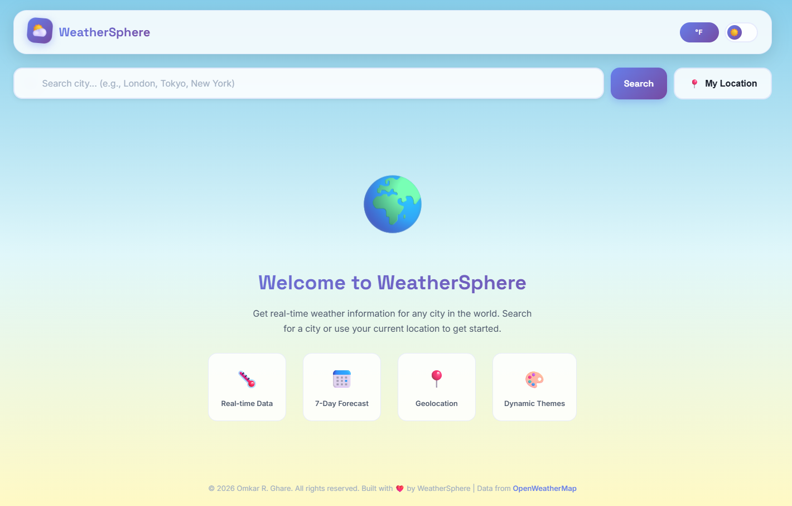

# 🌦️ WeatherSphere — Interactive Weather Application

A modern, interactive weather application built using **HTML5, CSS3, and JavaScript**. WeatherSphere provides a visually engaging way to explore weather conditions, search for cities, view forecasts, and personalize the interface.

<!-- Project Preview -->
<div align="center">
  
  <p><strong>Explore the weather with an interactive and responsive interface.</strong></p>
</div>

---

## 🌐 Live Demo

**Live Preview:** Add your deployed website URL here.

<!-- Replace the placeholder above with your GitHub Pages URL after deployment. -->

## ✨ Features

- 🌍 **City-Based Weather Search** — Search for weather information by city name.
- 📍 **Current Location** — Retrieve weather information using your device's location.
- 🌡️ **Current Weather Conditions** — View temperature, feels-like temperature, and weather descriptions.
- 💧 **Detailed Weather Information** — Explore humidity, wind speed, visibility, and atmospheric pressure.
- ⏰ **Hourly Forecast** — View upcoming hourly weather conditions.
- 📅 **Extended Forecast** — Explore the available multi-day weather forecast.
- ☀️ **Sunrise and Sunset** — Display local sunrise and sunset information.
- 🌡️ **Temperature Units** — Switch between Celsius and Fahrenheit.
- 🌗 **Light and Dark Modes** — Customize the appearance of the application.
- 🔎 **City Autocomplete** — Get city suggestions while typing.
- 🕘 **Search History** — Access previously searched locations.
- 🎨 **Animated Weather Effects** — Experience dynamic backgrounds and weather-related animations.
- 💾 **Local Storage** — Preserve supported preferences and search history between sessions.
- 📱 **Responsive Design** — Adapt the interface to different screen sizes.

*Note: Feature availability depends on successful API responses and the weather data provided by the configured API.*

## 🛠️ Technologies Used

| Technology | Purpose |
|---|---|
| HTML5 | Application structure |
| CSS3 | Styling, animations, and responsive layouts |
| JavaScript | Application logic and interactivity |
| OpenWeather API | Weather data and forecasts |
| Browser Geolocation API | Current-location functionality |
| Browser Local Storage | Persisting preferences and search history |

## 📂 Project Structure

```text
WeatherSphere/
│
├── index.html
│
├── css/
│   └── style.css
│
├── js/
│   └── script.js
│
├── images/
│   └── preview.png
│
└── README.md
```

## ⚙️ Getting Started

Follow these steps to run WeatherSphere locally.

### 1. Clone the Repository

```bash
git clone https://github.com/ghareomkarr88/weathersphere-weather-app.git
```

Replace `YOUR-USERNAME` with your GitHub username.

### 2. Open the Project

```bash
cd weathersphere-weather-app
```

### 3. Configure the Weather API

WeatherSphere uses the OpenWeather API to retrieve weather information.

1. Create an account on the [OpenWeather website](https://openweathermap.org/).
2. Obtain an API key and ensure the required API services are available to your account.
3. Open `js/script.js`.
4. Locate the `CONFIG` object.
5. Configure the API key for local testing.

**Important security note:** A key placed in browser-side JavaScript is visible to anyone using the application. Never commit a private or unrestricted API key to a public repository. For a publicly deployed application, use a backend API proxy to protect the key and apply appropriate usage restrictions.

### 4. Launch the Application

Open `index.html` in your browser or use the **Live Server** extension in Visual Studio Code.

Using a local development server is recommended for testing browser features such as geolocation.

### 5. Allow Location Access

To use the current-location feature, grant location permission when your browser requests it. Geolocation generally requires HTTPS or a trusted local development environment.

## 🔑 API Configuration

WeatherSphere is designed to retrieve weather information from OpenWeather.

The JavaScript configuration contains settings for API endpoints, weather icons, search history, and autocomplete behavior.

Before deploying the application:

- Configure a valid API key.
- Confirm that the required API endpoints are accessible with your account.
- Test city search, forecasts, and geolocation.
- Handle API errors and request limits appropriately.
- Avoid exposing personal API credentials in public source code.

## 🎨 Customization

You can personalize WeatherSphere by editing the following files:

- **`index.html`** — Update the application content and structure.
- **`css/style.css`** — Customize colors, typography, layouts, animations, and responsive styles.
- **`js/script.js`** — Modify application behavior, API integration, weather rendering, and interactions.
- **`images/preview.png`** — Replace the project preview with an updated screenshot.

## 📱 Responsive Experience

The application includes responsive styling intended to support different screen sizes. Test the layout on desktop, tablet, and mobile devices to ensure a consistent experience.

## 🎯 Project Goals

WeatherSphere demonstrates front-end development concepts, including:

- DOM manipulation and event handling.
- Asynchronous JavaScript and Fetch API.
- Third-party API integration.
- Browser geolocation.
- Local storage.
- Dynamic UI rendering.
- Responsive CSS layouts.
- Interactive themes and animated effects.

## 👨‍💻 Author

**Omkar Rohidas Ghare**

Front-End Developer | HTML | CSS | JavaScript

- GitHub: [@ghareomkarr88](https://github.com/ghareomkarr88)

Replace the placeholders with your actual name and GitHub profile.

## 📄 License

No license has been specified for this project yet.

Before adding a license, choose one that matches how you want others to use, modify, and distribute your work.

---

<div align="center">

**WeatherSphere — Discover the weather around you. 🌦️**

Built with HTML, CSS, and JavaScript.

</div>
